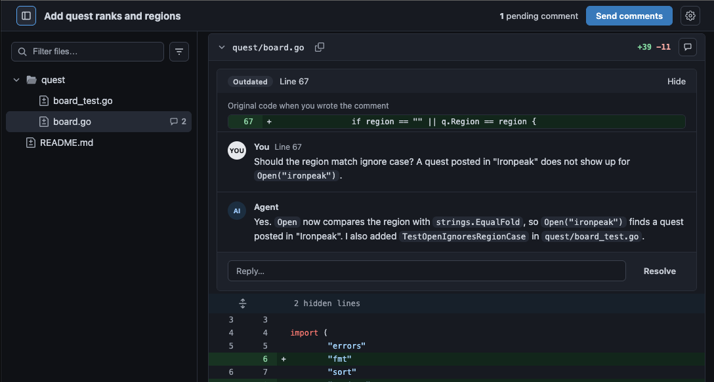
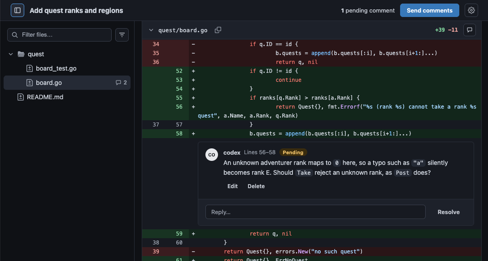

# hrev

hrev ("human review") lets you review the code that your coding agent (Claude Code or Codex) wrote, the way you review a pull request. You comment on lines in your browser, and the agent changes the code and replies in each thread.



## How it works

1. You ask the agent for a review, for example "open a review of the last commit".
2. The agent writes the diff to a file and runs `hrev open` in the background. Your browser opens the review.
3. You write comments. Hover a line and click the **+** button to comment on it, or drag the button to select a range. Comments support Markdown, suggestion blocks and pasted images. Unchanged code around each change is folded; click a fold to read more.
4. You click **Send comments**, or **Ask now** on a single comment.
5. The agent gets the comments, changes the code, refreshes the diff and replies in each thread.
6. You read the replies and resolve the threads. Only you resolve threads.

The agent learns all of this from the hrev skill.

## Install

Download the archive for your platform from the [releases](https://github.com/luisgabrielroldan/hrev/releases) page. Each archive contains the `hrev` binary (`hrev.exe` on Windows). Linux and macOS get a `.tar.gz` archive, Windows gets a `.zip` archive. The file `checksums.txt` has the SHA-256 checksum of each archive.

To build from source, you need Go 1.24 or later and Node.js 22.18 or later.

```sh
git clone https://github.com/luisgabrielroldan/hrev.git
cd hrev
make build BIN=~/.local/bin/hrev
```

`make build` builds the viewer first and then the Go binary, which embeds the viewer. A plain `go build` without the viewer build gives a binary that shows only a message in the browser.

Put `hrev` in a folder on your `PATH`. Then install the skill for your agent:

```sh
hrev skill install ~/.claude/skills   # Claude Code
hrev skill install ~/.codex/skills    # Codex
```

The skill is a small stub that tells the agent to run `hrev skill`. The full instructions come from the binary, so they always match the installed version.

## A second reviewer

Another agent can review the same session. Click **Copy session** in the viewer and give the copied text to the other agent, for example "review hrev session 05546204". That agent adds comments with `hrev comment --author <name>`. Its comments stay pending until you send them.



## Commands

```
hrev open <file.diff> --dir <folder> [--title T] [--description D] [--source CMD] [--replace ID [--force]]
hrev open --resume <id>
hrev refresh <id> <file.diff> [--title T] [--description D] [--source CMD]
hrev show <id>
hrev wait <id>
hrev state <id>
hrev reply <id> <thread-id> [<text>]
hrev comment <id> <file> [--lines N[-M]] [--side old|new] [--author NAME] [<text>]
hrev comment <id> --thread <thread-id> [--author NAME] [<text>]
hrev skill
hrev skill install <dir> [--force]
```

The agent runs these commands. You do not need them for a normal review. [SPEC.md](SPEC.md) describes the full behavior.

## Development

The viewer is a TypeScript app in `ui/`, built with Preact and esbuild. The build writes 1 HTML file with inline CSS and JavaScript to `internal/web/dist/index.html`, and the Go binary embeds that file.

```sh
make build   # build the viewer, then the binary
make test    # type check and test the viewer, then go vet and go test
make e2e     # browser tests of the viewer against the real binary
make coverage  # coverage of all tests together; the HTML report is in .coverage/js
make ui      # build only the viewer
make dist    # release archives for all platforms in dist/
```

`hrev version` prints the version. A release build prints the tag. A build from a checkout prints the output of `git describe`.

## Release

Push a tag that starts with `v`:

```sh
git tag v0.1.0
git push origin v0.1.0
```

The release workflow (`.github/workflows/release.yml`) runs the tests, runs `make dist VERSION=<tag>` and publishes a GitHub release with the archives and the checksums. A tag with a hyphen, such as `v0.1.0-rc.1`, gives a pre-release. The test workflow (`.github/workflows/test.yml`) runs on each push to `main` and on each pull request.

`make e2e` uses the installed Google Chrome. Without Chrome, run `npx playwright install chromium` in `ui/` and set `PW_CHANNEL=` (empty).

## Security

The server listens only on `127.0.0.1`. The viewer URL contains a random token, and the server rejects every request without it. Other web pages in your browser therefore cannot send comments to your agent.

## License

[MIT](LICENSE)
